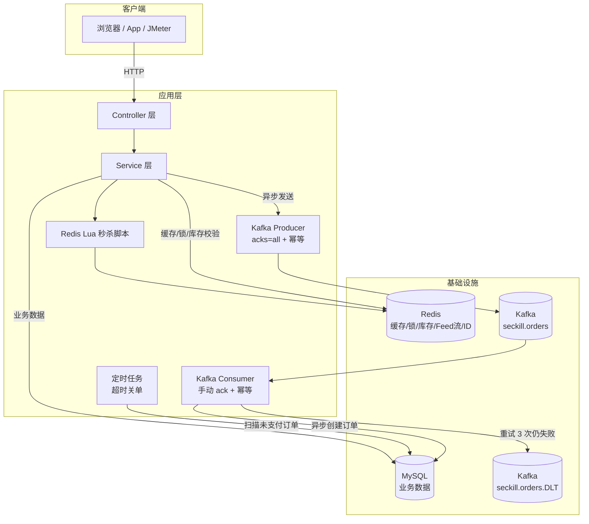
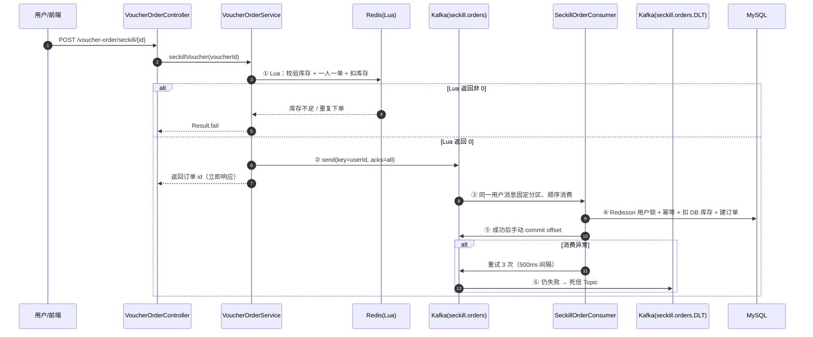

# sun_life（黑马点评 · 秒杀模块 Kafka 改造版）

> 基于黑马程序员《Spring Boot 实战》课程项目 **hm-dianping** 二次开发。核心改造：秒杀链路从 **Redis Stream 异步下单**升级为 **Kafka 异步下单**（`acks=all` + 幂等生产者 + 手动提交 offset + 重试/DLT）；技术栈升级到 **Java 21（虚拟线程）/ Spring Boot 3 / MySQL 8 / Redis 7 / Kafka 3.7**；补齐**布隆过滤器、TTL 抖动、点赞 BitMap、UV HyperLogLog** 等缓存与统计能力。本项目用于学习与简历展示，**非独立自研项目**，改造与新增部分为本人独立完成。

---

## 一、项目定位

本地生活服务平台后端（类大众点评/美团），围绕 **店铺缓存、秒杀、关注 Feed 流、附近商铺、签到、点赞** 等核心业务，重点解决高并发场景下的**缓存一致性**与**秒杀下单可靠性**问题。

| 关注点 | 说明 |
| --- | --- |
| 业务形态 | 商户/优惠券/笔记/关注/签到/秒杀 |
| 并发难点 | 秒杀瞬时流量、缓存穿透/击穿、Feed 流分页、超卖与重复下单 |
| 改造重点 | 秒杀异步下单链路：Redis Stream → Kafka 异步消息 |

---

## 二、技术栈

| 分类 | 技术 | 用途 |
| --- | --- | --- |
| 基础框架 | Spring Boot 3.3.5 / Java 21 | 应用骨架；Tomcat 请求线程使用虚拟线程（`VIRTUAL_THREADS=false` 可关闭） |
| 持久层 | MyBatis-Plus 3.5.7 / MySQL 8 | ORM 与数据存储 |
| 缓存 | Redis 7（StringRedisTemplate） | 缓存、布隆过滤器、BitMap、HyperLogLog、GEO、ZSet Feed 流 |
| 分布式锁 | Redisson 3.32.0 | 可重入锁、防重复下单、联锁（测试） |
| **消息队列** | **Kafka 3.7（spring-kafka 3.2.4）** | **秒杀异步下单、手动提交 offset、重试 + 死信 Topic** |
| 其他 | Hutool / Spring AOP / Lombok | 工具、代理事务 |

---

## 三、系统架构



## 四、核心亮点

### 4.1 秒杀模块：Kafka 异步下单（核心改造）

**升级动机（为什么不用 Redis Stream 了）**

原课程方案（Redis Stream 异步化）存在以下问题：

1. **消费能力受限**：单线程消费（`newSingleThreadExecutor`），水平扩展困难；
2. **失败无自动重试**：消费异常仅靠 pending-list 手动补偿，无重试策略、无死信；
3. **消息存于 Redis 内存**：无 Broker 落盘，可靠性依赖 Redis 持久化配置；
4. **无积压治理能力**：Kafka 的分区、消费组与 offset 体系更适合削峰和水平扩展。

**改造后的链路**



**可靠性设计要点**

| 问题 | 方案 |
| --- | --- |
| 扣库存成功但消息没发出去 | 发送回调失败时执行 `seckill_rollback.lua`，回滚 Redis 库存与去重标记 |
| Broker 抖动 / 副本切换 | `acks=all` + `enable.idempotence=true` + `retries`，消息落盘后才算成功 |
| 消费失败 | `DefaultErrorHandler` 固定间隔重试 3 次，耗尽后投递 `seckill.orders.DLT` |
| 重复投递（At Least Once） | 手动提交 offset + 订单 id 幂等判断 + 数据库主键 |
| 消费并发与顺序 | 3 分区 × `concurrency=3`；userId 作消息 key，同一用户固定分区 |
| 订单超时未支付 | Kafka 没有延迟消息，`@Scheduled` 每分钟扫描未支付订单，条件更新 `WHERE status=1` 关单并回补 DB + Redis 库存 |
| 削峰填谷 | 接口只做 Lua + 异步 send；消费端按 MySQL 能力消费，12 万独立用户压测中 6.4 万积压约 7 分钟追平 |

> 已知边界：Lua 扣减成功、Kafka send 之前进程崩溃，仍会出现「扣了库存但没有订单」。
> 彻底解决需要 outbox / 本地消息表；当前实现用发送回调补偿覆盖 Kafka 侧失败，属于课程项目的取舍。

### 4.2 缓存：穿透 / 击穿 / 雪崩

| 问题 | 方案 | 实现位置 |
| --- | --- | --- |
| **穿透** | Redis BitMap 布隆过滤器前置拦截（设计容量默认 100 万条、可配置，误判率 1%，双哈希 7 个函数）；另保留空值缓存兜底 | `RedisBloomFilter` / `BloomFilterInitializer` |
| **击穿** | 互斥锁（`SimpleRedisLock` + Redisson）与 **逻辑过期** 双方案，封装通用 `CacheClient` | `CacheClient` |
| **雪崩** | 所有 TTL 统一叠加 **±10% 随机抖动**，避免同批 key 同时失效 | `CacheClient#jitteredSeconds` |
| **一致性** | 先更新 DB 再删缓存，配合过期兜底 | `ShopServiceImpl#update` |

布隆过滤器在应用启动时批量预热已有商铺 id（一次 pipeline 写入），新增商铺在 DB 命中后按需补写；
不存在的 id 直接返回，不查 Redis、不打 MySQL（可用 `/shop/999999` 验证）。

### 4.3 点赞 BitMap 与 UV HyperLogLog

- **点赞关系**：由 ZSet 改为 **BitMap**，`userId` 直接作为 bit offset，点赞/取消/判断都是 O(1)、每用户 1 bit；
- **TopN 展示**：另保留一个 **有界 ZSet**（最多 1000 个用户）记录点赞时间，用于「点赞用户 Top5」，不会无限增长；
- **日 UV**：笔记详情页按 `uv:blog:{id}:{yyyyMMdd}` 写入 HyperLogLog，固定约 12KB/键，35 天自动过期；
  新增 `GET /blog/uv/{id}?date=yyyyMMdd` 查询；
- **点赞数异步回写**：点赞只写 Redis，±1 增量记在 `blog:like:delta`，`LikeCountFlusher` 每 5s 合并成一条 `UPDATE`
  批量回写 `tb_blog.liked`；`LIKE_ASYNC_FLUSH=false` 回到同步写库（可见性最多延迟一个周期，见 `docs/behavior-changes.md` 1.13）。

内存实测（10 万个用户，`MEMORY USAGE`）：

| 结构 | 100k 用户内存 |
| --- | ---: |
| BitMap（userId 作 offset） | **16,448 B（约 16KB）** |
| ZSet（userId → 时间戳） | **8,569,376 B（约 8.2MB）** |

### 4.4 其他业务能力

- **登录**：短信验证码（Redis 存储）+ Token 会话 + 双拦截器（登录校验 + Token 刷新续期）；
- **关注/Feed 流**：Redis ZSet 实现关注列表、共同关注、收件箱滚动分页（按时间戳，无重复无遗漏）；发笔记经 Kafka 异步分批推送，大 V 不推送、读取时合并其发件箱（推拉结合）；
- **附近商铺**：Redis GEO 按距离检索；
- **签到**：BitMap 按月聚合；
- **分布式锁**：SETNX + 过期时间 + Lua 校验持有者，另对比 Redisson 的可重入与看门狗；
  `perf/lock-failover-demo.ps1` 可复现「主从切换后锁丢失」，最终以「Redis 锁 + 数据库唯一索引」双层兜底；
- **全局 ID**：Redis 自增 + 时间戳拼接，支持多实例。

---

## 五、性能压测（JMeter，真实数据）

### 5.1 压测口径

| 项 | 值 |
| --- | --- |
| 工具 | Apache JMeter 5.6.3，非 GUI 模式 + HTML Dashboard |
| 场景 A | `POST /voucher-order/seckill/21`，持续 30s，200 / 500 / 1000 并发 |
| 场景 B | `GET /shop/1`，持续 30s，200 并发；`HMDP_CACHE_ENABLED=false` 时直查 MySQL |
| 数据 | 1000 个真实用户 Token（写入 Redis），秒杀券库存 100,000 |
| 环境 | Windows 11 单机 + Docker Desktop：应用 / MySQL 8 / Redis 7 / Kafka 3.7 同机，非生产集群 |
| 脚本 | `perf/seckill-bench.jmx`、`perf/shop-detail-bench.jmx`（均已入库） |

### 5.2 秒杀接口结果（Java 17 + Spring Boot 3.3.5 + Kafka 异步消息）

> 这一组是 2026-11-10 的历史数据，当时还没升级 JDK 21，也没有阶段 3 的本地缓存、售罄标记、订单号本地生成等改造；
> 与当前代码对应的容量见 5.5 的 2026-11-24 本机基线。

| 并发 | 请求数 | 吞吐（QPS） | 平均 RT | P95 | P99 | 错误率 |
| ---: | ---: | ---: | ---: | ---: | ---: | ---: |
| 200 | 285,334 | **9,580** | 20.4 ms | 27 ms | 31 ms | 0% |
| 500 | 299,624 | **10,077** | 49.1 ms | 60 ms | 73 ms | 0.01% |
| 1000 | 292,060 | **9,791** | 100.7 ms | 113 ms | 117 ms | 0.31%（TCP 连接拒绝） |

**数据一致性**：三轮压测均为 `订单数 = 去重用户数 = 1000`，DB 与 Redis 库存均为 `100,000 - 1,000 = 99,000`，
**零超卖、零重复下单**。

### 5.3 商铺详情缓存 A/B（200 并发，30s）

| 指标 | 开启缓存 + 布隆过滤器 | 关闭缓存直查 MySQL | 变化 |
| --- | ---: | ---: | ---: |
| 吞吐（QPS） | **10,494** | 8,367 | +25.4% |
| 平均 RT | **18.6 ms** | 23.5 ms | -20.9% |
| P95 RT | **51 ms** | 62 ms | -17.7% |
| P99 RT | **77 ms** | 86 ms | -10.5% |
| 压测期间 MySQL 查询量 | **7 次** | 250,550 次 | 约 -99.99% |

> 本机 MySQL 与应用同机、无网络 RTT，所以延迟差距不夸张；但 MySQL 查询量从 25 万降到个位数，
> 说明布隆过滤器 + 缓存确实把这份压力挡在了数据库之外。

### 5.4 HyperLogLog 误差实测

10 轮独立试验，每轮 5 万个不同用户：`PFCOUNT` 与真实值平均绝对误差 **0.53%**，
理论标准误差 0.81%，符合预期。

### 5.5 容量基线（阶段 3-1，本机受控基线）

> 2026-11-24 实测，数据量 10 万用户 / 1 万店铺 / 100 万订单 / 5 万笔记 / 30 万关注（149 MB）。
> **压测机 = 被测机**：服务跑在 WSL2（16 vCPU / 20 GB），JMeter 在 Windows 宿主，共享同一颗 CPU，
> 数字只能当这台机器的下限；分机扩展效率未测。口径、逐级数据和瓶颈归因见
> [docs/capacity-baseline-report.md](docs/capacity-baseline-report.md)。

组件上限（客户端同机，下限值）：

| 组件 | 结果 |
| --- | --- |
| Redis GET / HGETALL / 单券 `seckill.lua` | 13.7 万 / 13.5 万 / 12.7 万 ops/s，P99 < 0.7 ms |
| MySQL 主键点查 / 热门笔记 | 20.2 万 / 14.9 万 次/s |
| MySQL 热点行扣库存 | 单条 **83 单/s**；批量 24 条约 85 次/s ⇒ **约 2,040 单/s** |
| Kafka 生产（acks=all）/ 消费 | 55.2 万 条/s / 138 万 条/s |

单实例拐点（P99 < 100 ms，错误率 < 0.1%）：

| 场景 | 拐点并发 / QPS | 安全容量（×60–70%） | 拐点时先到顶的 |
| --- | ---: | ---: | --- |
| 店铺详情 `/shop/{id}` | 200 / 25,438 | 15.3k–17.8k | 400 并发时服务端 P99 仅 14 ms，**压测端先到顶** |
| 混合场景（店铺 70 / 笔记 15 / Feed 10 / 秒杀 5） | 100 / 14,977 | 9.0k–10.5k | 应用侧：`/blog/hot` P99 251 ms、Feed 335 ms |
| 秒杀 `/voucher-order/seckill/21` | 100 / 17,361 | 10.4k–12.2k | 400 并发时服务端 P99 33 ms，**压测端先到顶** |

- 测试区间内第一个饱和的不是 Redis / MySQL / Kafka，而是**应用侧处理与排队**；秒杀的硬上限是单券热点行写（批量聚合后约 2k 单/s）；
- 顺带修掉两个真问题：旧数据卷缺 `migration_v2.sql` 索引（热门笔记 799 → 148,932 次/s）、
  nginx 1.18 + Tomcat 默认每条连接只处理 100 个请求（20k QPS 下端口耗尽，出现 1.33% `BindException`）。

### 5.6 结论（怎么向面试官讲）

1. 秒杀链路在 200~1000 并发下保持 **约 9,600~10,000 QPS**，1000 并发时 P99 117ms，主要错误是本地 Windows
   accept 队列溢出导致的 TCP 连接拒绝，不是业务错误；
2. Kafka 用 `userId` 作 key 保证同用户分区内有序；失败重试 3 次后进入 `seckill.orders.DLT`，
   已用一条非法消息验证过死信链路；
3. 缓存链路的价值可以用 **MySQL 查询量**直接量化：同压下从 25 万次降到 7 次；
4. 布隆过滤器能把「不存在的 id」挡在 Redis 之前（`/shop/999999` 不产生 SQL）；
5. 点赞 BitMap 相比 ZSet，10 万用户内存从 **8.2MB 降到 16KB**；UV 用 HLL，5 万 UV 误差约 **0.5%**；
6. 阶段 3-1 的本机基线（5.5）进一步证明：读路径不是瓶颈，秒杀的硬上限是单券热点行写；混合场景的拖尾在应用侧的
   热门笔记 / Feed，所以 3-2 先做低风险的应用层优化，库存分段只在目标单券峰值超过约 2k/s 时才做。

> 完整数据：`perf/report-*/statistics.json` 与 `perf/*.jtl`（本地生成，未入库）；
> 复现步骤见 `perf/README.md`。

---

## 六、快速启动

### 6.1 方式一：Docker 一键启动（推荐，已实测通过）

前置：Docker Engine 20.10+ 与 compose 插件（Linux/WSL2），或 Docker Desktop（Windows/macOS），Maven 3.6+。

```bash
# 一键启动（自动完成：编译 jar → 构建镜像 → 启动 MySQL/Redis/Kafka/应用）
# Windows
deploy\start.bat
# Linux / macOS
sh deploy/start.sh

# 查看状态
docker compose -f deploy/docker-compose.yml ps

# 停止（数据卷保留，再次启动数据不丢）
deploy\stop.bat   # 或 sh deploy/stop.sh
```

**编排内容**（`deploy/docker-compose.yml`）：

| 服务 | 镜像 | 说明 |
| --- | --- | --- |
| `mysql` | mysql:8.0 | 首次启动自动导入 `hmdp.sql` 建库建表（关闭严格模式兼容课程 SQL），数据卷 `hmdp-mysql8-data` |
| `redis` | redis:7.2 | 缓存/布隆过滤器/位图/HLL/锁/库存 |
| `kafka` | apache/kafka:3.7.0 | KRaft 单节点，秒杀异步消息 / 重试 / DLT |
| `app` | 本地构建（eclipse-temurin:21-jre） | Spring Boot 3 应用，无状态，可 `--scale app=N` 多副本 |
| `frontend` | nginx:1.18-alpine | 前端静态页 + 网关：`/api`（8080）与 8081 入口均负载均衡到所有 `app` 副本，秒杀接口限流 |

> 访问方式：
> - **前端页面（推荐）**：浏览器打开 `http://localhost:8080`（nginx 托管，登录/秒杀均在页面操作）
> - 后端 API（调试）：`http://localhost:8081`，根路径会被登录拦截器返回 401，属正常行为
>
> 端口映射默认避开本机冲突（MySQL 3307、Redis 6380、Kafka 9092），
> 可在 `deploy/.env` 中修改；应用宿主端口默认 8081（`APP_PORT`）、前端端口默认 8080（`WEB_PORT`）。
> 秒杀库存由应用启动时自动预热（见 4.1 可靠性设计 / `SeckillStockInitializer`），无需手动初始化。
> 扩容到多副本：`docker compose -f deploy/docker-compose.yml up -d --scale app=3`，之后 `restart frontend` 让 nginx 重新解析副本。
> 已有数据卷的环境需补索引：`docker exec -i hmdp-mysql mysql -uroot -p123456 hmdp < src/main/resources/db/migration_v2.sql`。
> 扩容路线与各阶段优化说明见 [docs/scaling-roadmap.md](docs/scaling-roadmap.md)。
> 监控（Prometheus + Grafana + exporter，Grafana `localhost:3000`）：主编排后追加 `-f deploy/docker-compose.monitoring.yml`，
> 说明见 [docs/monitoring.md](docs/monitoring.md)。
>
> **实测记录**（Docker Desktop 4.91 + WSL2 后端）：
> 一键启动后 5 个服务全部健康；前端 `localhost:8080` 页面可访问，经 `/api` 代理登录 → 秒杀下单 → Kafka
> 异步创建订单全链路通过；重复下单被"一人一单"拦截，库存正确扣减。所有服务配置
> `restart: unless-stopped`，daemon 异常重启后会自动恢复。

### 6.2 方式二：本地直接启动

| 组件 | 要求 |
| --- | --- |
| JDK | 17 |
| Maven | 3.6+ |
| MySQL | 8.0+，导入 `src/main/resources/db/hmdp.sql` |
| Redis | 7.x，默认 `127.0.0.1:6379` |
| Kafka | 3.7.x，默认 `127.0.0.1:9092` |

```bash
# 1. 启动 MySQL / Redis / Kafka（Kafka 可直接用 perf/docker-compose-kafka.yml）
docker compose -f perf/docker-compose-kafka.yml up -d

# 2. 编译运行（启动时自动预热秒杀库存、自动创建 Kafka topic）
mvn clean package -DskipTests
java -jar target/sun_life-0.0.1-SNAPSHOT.jar
```

### 6.3 接口冒烟

| 接口 | 说明 |
| --- | --- |
| `POST /user/code` `{phone}` | 发送验证码（日志打印） |
| `POST /user/login` `{phone, code}` | 登录，返回 Token |
| `POST /voucher-order/seckill/{id}` | 秒杀，Header `authorization: {token}`，返回订单 ID |
| `GET /voucher-order/status/{orderId}` | 轮询异步下单结果（0=处理中，1=未支付，4=已取消） |
| `POST /voucher-order/pay/{orderId}` | 模拟支付（学习用） |

> 完整接口文档见 `hmdp-接口文档.md`，Postman 集合见 `hmdp-postman-collection.json`。

### 6.4 压测复现

```powershell
# 秒杀券 + Redis 库存 + 1000 个 token
docker exec -i hmdp-mysql mysql -uroot -p123456 hmdp < perf/bench-voucher.sql
docker exec hmdp-redis redis-cli SET seckill:stock:21 100000
pwsh perf/gen_tokens.ps1 -Count 1000

# 500 并发秒杀
jmeter -n -t perf/seckill-bench.jmx -JTHREADS=500 `
  -JTOKEN_FILE=./token.txt -JSERVER_PORT=8081 `
  -l perf/500.jtl -e -o perf/report-500

# 商铺详情缓存 A/B
jmeter -n -t perf/shop-detail-bench.jmx -JTHREADS=200 -JSERVER_PORT=8081 `
  -l perf/shop-cache.jtl -e -o perf/report-shop-cache
```

完整口径、重置脚本与实测数据见 [`perf/README.md`](perf/README.md)。
容量基线（组件单测、单实例拐点、扩展效率、混合场景、容量模型）见 [`perf/baseline/README.md`](perf/baseline/README.md)；
2026-11-24 的本机实测结果与瓶颈归因见 [`docs/capacity-baseline-report.md`](docs/capacity-baseline-report.md)。

---

## 七、工程说明

### 7.1 新增/改造文件（vs 原版）

| 文件 | 说明 |
| --- | --- |
| `mq/KafkaConstants.java` | 秒杀 topic、DLT、消费者组常量 |
| `mq/SeckillOrderMessage.java` | 订单消息体 |
| `mq/SeckillOrderConsumer.java` | 手动提交 offset + Redisson 用户锁 + 订单幂等 |
| `mq/SeckillOrderDltConsumer.java` | 死信消息告警/排查 |
| `mq/OrderTimeoutScheduler.java` | 定时扫描未支付订单并关单 |
| `config/KafkaConfig.java` | topic 创建 + 重试 3 次 + 死信发布 |
| `service/impl/VoucherOrderServiceImpl.java` | Lua 扣减 + 异步 Kafka + 发送失败回滚 + 超时关单 |
| `resources/seckill.lua` / `seckill_rollback.lua` | Lua 只做扣减；新增投递失败补偿脚本 |
| `config/SeckillStockInitializer.java` | 启动时自动预热秒杀库存到 Redis（幂等，Docker 一键启动后立即可秒杀） |
| `utils/RedisBloomFilter.java` | Redis BitMap 布隆过滤器（双哈希、一条 BITFIELD 读写、容量可配置、key 带位图参数） |
| `config/BloomFilterInitializer.java` | 启动时按 id 游标分批把商铺 id 预热进布隆过滤器，之后定时增量同步 |
| `utils/CacheClient.java` | 空值缓存 + 互斥锁/逻辑过期 + TTL ±10% 抖动 |
| `service/impl/BlogServiceImpl.java` | 点赞 BitMap（userId 作 offset）+ 有界 ZSet TopN + 日 UV HyperLogLog + 点赞增量异步回写 |
| `mq/LikeCountFlusher.java` | 点赞数定时批量回写 `tb_blog.liked`（改名取批、失败保留重试、Redisson 锁） |
| `controller/BlogController.java` | 新增 `GET /blog/uv/{id}` 日 UV 查询 |
| `pom.xml` / `application.yaml` / `deploy/Dockerfile` / `deploy/docker-compose.yml` | 升级 Java 21 / Spring Boot 3 / MySQL 8 / Redis 7，补齐 Boot 3 配置 |
| `perf/gen_tokens.ps1` / `perf/bench-voucher.sql` / `perf/shop-detail-bench.jmx` | 无 Python 依赖的压测数据准备与缓存 A/B 脚本 |
| `perf/lock-failover-demo.ps1` | 复现 Redis 主从切换导致分布式锁失效，验证 DB 唯一索引兜底的必要性 |

### 7.2 目录结构

```
src/main/java/com/hmdp/
├── controller/    # 接口层
├── service/       # 业务层（含秒杀改造）
├── mq/            # Kafka 生产/消费/DLT/超时任务（新增）
├── utils/         # Redis ID、锁、拦截器、缓存工具类
├── config/        # Redisson/MyBatis/MVC 配置
├── entity/ dto/ mapper/
```

---

## 八、已知限制与后续规划

- [ ] 支付为模拟接口，未接入真实支付回调与对账；
- [ ] 应用层全局限流 / 熔断未接入（秒杀接口在网关按 IP 限流 20r/s 已实现，DB 回源另有并发闸）；
- [ ] 多副本已支持并验证过功能；**扩展效率（线性度）尚未在压测机分离的环境实测**，本机基线见
      [`docs/capacity-baseline-report.md`](docs/capacity-baseline-report.md)；
- [x] 超时关单多实例互斥（Redisson 锁，集群内同一时刻只有一个实例执行）；
- [ ] Lua 扣减成功与 Kafka 投递之间仍存在极小窗口，生产可用 outbox / 本地消息表彻底解决；
- [x] Docker 一键启动（`deploy/`，MySQL/Redis/Kafka/应用 全容器化）。

---

*本项目为学习项目，基于黑马程序员 hm-dianping 课程源码二次开发，仅供学习交流。*
