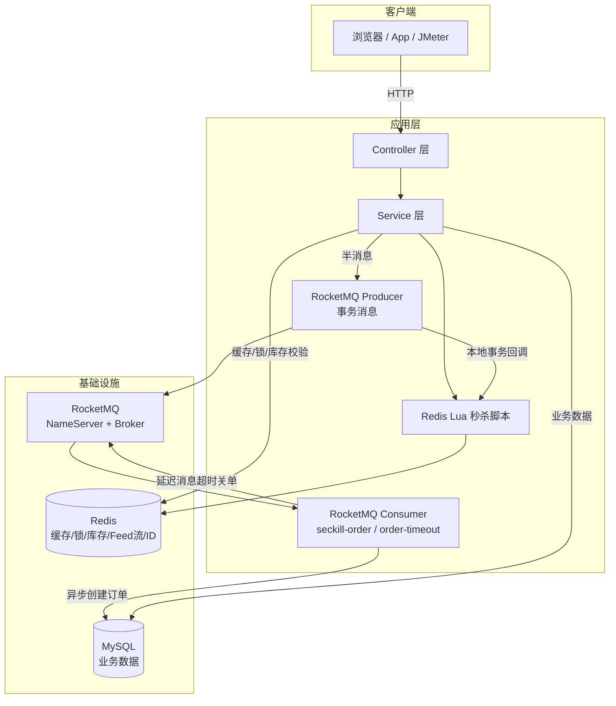
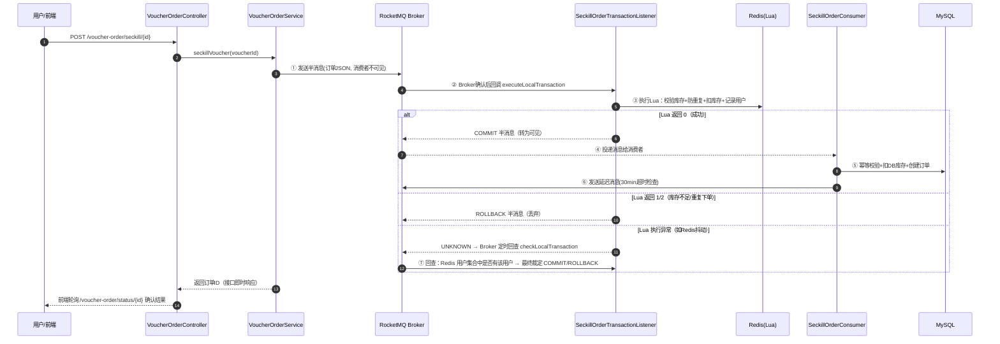

# sun_life（黑马点评 · 秒杀模块 RocketMQ 改造版）

> 基于黑马程序员《Spring Boot 实战》课程项目 **hm-dianping** 二次开发，核心改造点：将秒杀模块的 **Redis Stream 异步下单**升级为 **RocketMQ 事务消息 + 异步下单**，补齐消息可靠性与订单超时闭环。本项目用于学习与简历展示，**非独立自研项目**，改造与新增部分为本人独立完成。

---

## 一、项目定位

本地生活服务平台后端（类大众点评/美团），围绕 **店铺缓存、秒杀、关注 Feed 流、附近商铺、签到、点赞** 等核心业务，重点解决高并发场景下的**缓存一致性**与**秒杀下单可靠性**问题。

| 关注点 | 说明 |
| --- | --- |
| 业务形态 | 商户/优惠券/笔记/关注/签到/秒杀 |
| 并发难点 | 秒杀瞬时流量、缓存穿透/击穿、Feed 流分页、超卖与重复下单 |
| 改造重点 | 秒杀异步下单链路：Redis Stream → RocketMQ 事务消息 |

---

## 二、技术栈

| 分类 | 技术 | 用途 |
| --- | --- | --- |
| 基础框架 | Spring Boot 2.7.18 / Java 8 | 应用骨架 |
| 持久层 | MyBatis-Plus 3.4.3 / MySQL | ORM 与数据存储 |
| 缓存 | Redis 5.x（StringRedisTemplate） | 缓存、分布式锁、GEO、ZSet Feed 流、全局 ID |
| 分布式锁 | Redisson 3.13.6 | 可重入锁、防重复下单、联锁（测试） |
| **消息队列** | **RocketMQ 4.9.7（rocketmq-spring-boot-starter 2.2.3）** | **秒杀异步下单、事务消息、延迟消息、死信队列** |
| 其他 | Hutool / Spring AOP / Lombok | 工具、代理事务 |

---

## 三、系统架构



## 四、核心亮点

### 4.1 秒杀模块：RocketMQ 事务消息异步下单（核心改造）

**升级动机（为什么不用 Redis Stream 了）**

原课程方案（Redis Stream 异步化）存在以下问题：

1. **消费能力受限**：单线程消费（`newSingleThreadExecutor`），水平扩展困难；
2. **失败无自动重试**：消费异常仅靠 pending-list 手动补偿，无重试策略、无死信队列；
3. **消息存于 Redis 内存**：无 Broker 落盘，依赖 Redis 持久化配置，可靠性弱；
4. **无延迟消息能力**：订单超时关单需自建定时任务；
5. **一致性缺口**：Lua 扣库存与消息投递虽同脚本原子，但缺少"本地事务结果上报失败后由 Broker 回查兜底"的机制——一旦业务在扣库存后、消息送达前崩溃，库存与订单会永久不一致。

**改造后的事务消息链路**



**可靠性设计要点**

| 问题 | 方案 |
| --- | --- |
| 扣库存与发消息不一致 | RocketMQ 事务消息：半消息 → Lua 本地事务 → COMMIT/ROLLBACK，二者绑定为同一原子决策 |
| 事务结果上报前进程崩溃 | Broker 定时回查 `checkLocalTransaction`（默认 60s，最多 15 次），依据 Redis 真实下单状态最终裁定 |
| 消息重复投递（At Least Once） | 消费端 Redisson 锁 + 订单存在性幂等判断 |
| 消费失败 | Broker 自动重试（默认 16 次），重试耗尽进入死信队列 `%DLQ%seckill-order-consumer` |
| 订单超时未支付 | 延迟消息（等级 16 = 30 分钟）触发关单，条件更新 `WHERE status=1` 防支付竞态，关单后回补 DB + Redis 库存 |
| 高并发库存扣减 | Lua 脚本 Redis 内原子完成"校验库存→防重复→扣库存→记录用户"，避免超卖 |

### 4.2 缓存：穿透 / 击穿双方案

- **缓存穿透**：缓存空值 + 短期 TTL；
- **缓存击穿**：互斥锁（`SimpleRedisLock` + Redisson）与 **逻辑过期** 双方案，封装通用 `CacheClient` 工具类；
- **缓存一致性**：先更新 DB 再删缓存，配合过期兜底。

### 4.3 其他业务能力

- **登录**：短信验证码（Redis 存储）+ Token 会话 + 双拦截器（登录校验 + Token 刷新续期）；
- **关注/Feed 流**：Redis ZSet 实现关注列表、共同关注、收件箱滚动分页（按时间戳，无重复无遗漏）；
- **附近商铺**：Redis GEO 按距离检索；
- **点赞/签到**：Set/ZSet 点赞、BitMap 月签到；
- **全局 ID**：Redis 自增 + 时间戳拼接，支持多实例。

---

## 五、性能压测（JMeter，真实数据）

### 5.1 压测口径

| 项 | 值 |
| --- | --- |
| 工具 | Apache JMeter 5.6.3，非 GUI 模式 + HTML Dashboard |
| 场景 | `POST /voucher-order/seckill/21`，持续 30s，固定并发 |
| 数据 | 1000 个真实用户 Token（写入 Redis），秒杀券库存 100,000 |
| 环境 | Windows 单机：应用 + MySQL + Redis + RocketMQ 同机（本地开发机，非生产集群） |
| 对比基线 | 同项目 Redis Stream 版（git 23d2991 原版），同一脚本、同一环境 |
| 脚本 | `perf/seckill-bench.jmx`（可复现） |

### 5.2 结果汇总

| 指标 | RocketMQ 事务消息版 | Redis Stream 版 |
| --- | ---: | ---: |
| **200 并发** | | |
| 吞吐（QPS） | 3,127 | 4,660 |
| 平均 RT | 63 ms | 42 ms |
| P99 RT | 129 ms | 93 ms |
| 错误率 | 0% | 0% |
| **1000 并发** | | |
| 吞吐（QPS） | 3,172 | 3,711 |
| 平均 RT | 310 ms | 265 ms |
| P99 RT | 403 ms | 344 ms |
| 错误率 | 2.40%（TCP 连接拒绝） | 1.09%（TCP 连接拒绝） |
| **数据一致性（1000 并发轮）** | | |
| 订单落库 | 1000 / 1000 | 1000 / 1000 |
| 库存扣减 = 订单数 = 用户数 | ✅ 无超卖/无重复 | ✅ 无超卖/无重复 |

### 5.3 结论（怎么向面试官讲）

1. **接口吞吐两者处于同一量级（3000+ QPS）**，RocketMQ 事务消息版略低约 15-25%：事务消息在接口侧多一次 Broker 往返（发送半消息 → 本地事务执行 → 提交确认），这是**用接口延迟换可靠性**的合理代价，量级无本质差距；
2. **真正的升级价值不在吞吐，在可靠性与可运维性**：自动重试 + 死信队列 + 延迟消息 + 事务回查 + 并发消费，这些是 Redis Stream 方案不具备的；
3. 两版在高并发下均无超卖、无重复下单（库存扣减 = 订单数 = 用户数），验证了 Lua 原子扣减 + 消费端幂等的正确性；
4. 错误率均为**本地压测 TCP 连接拒绝**（Windows accept 队列瞬时溢出，`Connection refused`），非业务错误，生产多实例 + 网关层可消除。

> 完整统计数据：`perf/stats/*.json`（已入库）；完整 HTML 报告在本地 `perf/report-*/`（含大量第三方静态资源，未入库）；压测脚本 `perf/seckill-bench.jmx`（已入库，可复现）。

---

## 六、快速启动

### 6.1 方式一：Docker 一键启动（推荐，已实测通过）

前置：Docker Engine 20.10+ 与 compose 插件（Linux/WSL2），或 Docker Desktop（Windows/macOS），Maven 3.6+。

```bash
# 一键启动（自动完成：编译 jar → 构建镜像 → 启动 MySQL/Redis/RocketMQ/应用）
# Windows
deploy\start.bat
# Linux / macOS
sh deploy/start.sh

# 查看状态
docker compose -f deploy/docker-compose.yml ps

# 停止（数据卷保留，再次启动数据不丢）
deploy\stop.bat   # 或 sh deploy/stop.sh
```

**编排内容**（`deploy/docker-compose.yml`）：

| 服务 | 镜像 | 说明 |
| --- | --- | --- |
| `mysql` | mysql:5.7 | 首次启动自动导入 `hmdp.sql` 建库建表（关闭严格模式兼容课程 SQL） |
| `redis` | redis:5.0 | 缓存/锁/库存 |
| `rocketmq-namesrv` / `rocketmq-broker` | apache/rocketmq:4.9.7 | 事务消息/延迟消息/死信 |
| `app` | 本地构建（Liberica JDK8） | Spring Boot 应用，环境变量自动指向容器服务名 |
| `frontend` | nginx:1.18-alpine | 黑马点评前端静态页 + `/api` 反向代理到 `app:8081` |

> 访问方式：
> - **前端页面（推荐）**：浏览器打开 `http://localhost:8080`（nginx 托管，登录/秒杀均在页面操作）
> - 后端 API（调试）：`http://localhost:8081`，根路径会被登录拦截器返回 401，属正常行为
>
> 端口映射默认避开本机冲突（MySQL 3307、Redis 6381、RocketMQ 9878/10912/10913），
> 可在 `deploy/.env` 中修改；应用端口固定 8081、前端端口默认 8080（`WEB_PORT`）。
> 秒杀库存由应用启动时自动预热（见 4.1 可靠性设计 / `SeckillStockInitializer`），无需手动初始化。
>
> **实测记录**（Docker Desktop 4.91 + WSL2 后端）：
> 一键启动后 6 个服务全部健康；前端 `localhost:8080` 页面可访问，经 `/api` 代理登录 → 秒杀下单 → RocketMQ
> 异步创建订单 → 延迟消息全链路通过；重复下单被"一人一单"拦截，库存正确扣减。所有服务配置
> `restart: unless-stopped`，daemon 异常重启后会自动恢复。

### 6.2 方式二：本地直接启动

| 组件 | 要求 |
| --- | --- |
| JDK | 1.8 |
| Maven | 3.6+ |
| MySQL | 5.7+，导入 `src/main/resources/db/hmdp.sql` |
| Redis | 5.x，默认 `127.0.0.1:6379` |
| RocketMQ | 4.9.x，NameServer `127.0.0.1:9876`，Broker `127.0.0.1:10911` |

```bash
# 1. 启动 MySQL / Redis（略）

# 2. 启动 RocketMQ（Windows）
cd %ROCKETMQ_HOME%\bin
start mqnamesrv.cmd
start mqbroker.cmd -n 127.0.0.1:9876

# 3. 编译运行（启动时自动预热秒杀库存）
mvn clean package -DskipTests
java -jar target/sun_life-0.0.1-SNAPSHOT.jar
```

### 6.3 接口冒烟

| 接口 | 说明 |
| --- | --- |
| `POST /user/code` `{phone}` | 发送验证码（日志打印） |
| `POST /user/login` `{phone, code}` | 登录，返回 Token |
| `POST /voucher-order/seckill/{id}` | 秒杀，Header `authorization: {token}`，返回订单 ID |
| `GET /voucher-order/status/{orderId}` | 轮询异步下单结果（0=处理中，1=未支付，4=已取消） |
| `POST /voucher-order/pay/{orderId}` | 模拟支付（学习用） |

> 完整接口文档见 `hmdp-接口文档.md`，Postman 集合见 `hmdp-postman-collection.json`。

---

## 七、工程说明

### 7.1 新增/改造文件（vs 原版）

| 文件 | 说明 |
| --- | --- |
| `mq/SeckillOrderTransactionListener.java` | 事务消息监听器：本地事务执行（Lua）+ 回查 |
| `mq/SeckillOrderConsumer.java` | 秒杀订单异步落库消费者 |
| `mq/OrderTimeoutConsumer.java` | 延迟消息超时关单消费者 |
| `mq/DemoDlqConsumer.java` | 死信队列演示（实验用） |
| `controller/DemoDlqController.java` | 死信演示触发接口 |
| `service/impl/VoucherOrderServiceImpl.java` | 秒杀主流程改造（事务消息 + 异步下单 + 超时关单） |
| `resources/seckill.lua` | Lua 去除 Stream xadd，改为事务消息回调执行 |
| `config/SeckillStockInitializer.java` | 启动时自动预热秒杀库存到 Redis（幂等，Docker 一键启动后立即可秒杀） |
| `pom.xml` / `application.yaml` | 新增 RocketMQ 依赖与配置 |
| `deploy/` | Docker 一键启动：Dockerfile / docker-compose.yml / broker.conf / 启停脚本 |

### 7.2 目录结构

```
src/main/java/com/hmdp/
├── controller/    # 接口层
├── service/       # 业务层（含秒杀改造）
├── mq/            # RocketMQ 生产/消费/事务监听（新增）
├── utils/         # Redis ID、锁、拦截器、缓存工具类
├── config/        # Redisson/MyBatis/MVC 配置
├── entity/ dto/ mapper/
```

---

## 八、已知限制与后续规划

- [ ] 支付为模拟接口，未接入真实支付回调与对账；
- [ ] 未做接口限流（可加 Redis 令牌桶）；
- [ ] 单机部署，未验证多实例消费水平扩展（RocketMQ 消费组天然支持）；
- [ ] 延迟消息使用 RocketMQ 4.x 固定 18 级延迟等级，5.x 支持任意时间点定时消息；
- [x] Docker 一键启动（`deploy/`，MySQL/Redis/RocketMQ/应用 全容器化）。

---

*本项目为学习项目，基于黑马程序员 hm-dianping 课程源码二次开发，仅供学习交流。*
