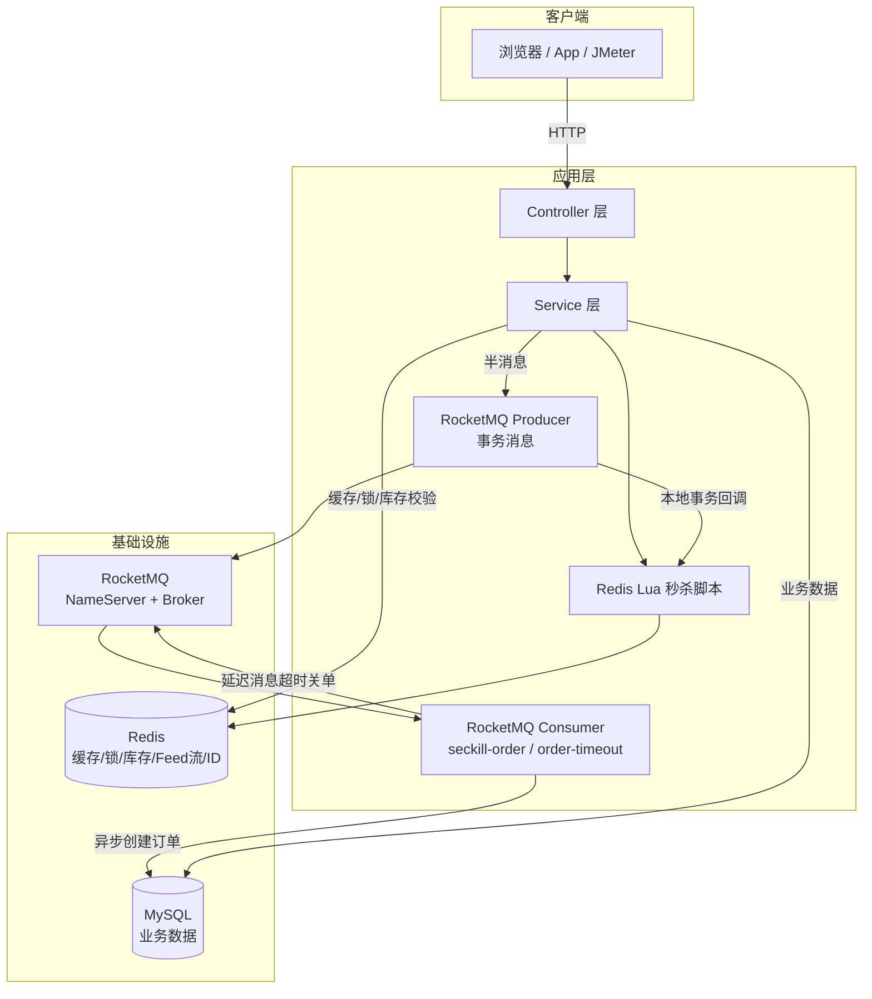
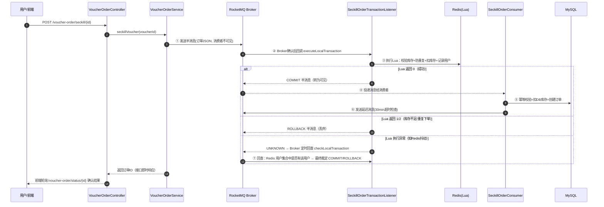

# sun_life（黑马点评 · 秒杀模块 RocketMQ 改造版）

> 基于黑马程序员《Spring Boot 实战》课程项目 **hm-dianping** 二次开发。核心改造：秒杀链路从 **Redis Stream 异步下单**升级为 **RocketMQ 事务消息 + 异步下单**；技术栈升级到 **Java 17 / Spring Boot 3 / MySQL 8 / Redis 7**；补齐**布隆过滤器、TTL 抖动、点赞 BitMap、UV HyperLogLog** 等缓存与统计能力。本项目用于学习与简历展示，**非独立自研项目**，改造与新增部分为本人独立完成。

---

## 一、项目定位

本地生活服务平台后端（类大众点评/美团），围绕 **店铺缓存、秒杀、关注 Feed 流、附近商铺、签到、点赞** 等核心业务，重点解决高并发场景下的**缓存一致性**与**秒杀下单可靠性**问题。

| 关注点 | 说明 |
| --- | --- |
| 业务形态 | 商户/优惠券/笔记/关注/签到/秒杀 |
| 并发难点 | 秒杀瞬时流量、缓存穿透/击穿、Feed 流分页、超卖与重复下单 |
| 改造重点 | 秒杀异步下单链路：Redis Stream → RocketMQ 事务消息 |

---

## 二、技术栈

| 分类 | 技术 | 用途 |
| --- | --- | --- |
| 基础框架 | Spring Boot 3.3.5 / Java 17 | 应用骨架 |
| 持久层 | MyBatis-Plus 3.5.7 / MySQL 8 | ORM 与数据存储 |
| 缓存 | Redis 7（StringRedisTemplate） | 缓存、布隆过滤器、BitMap、HyperLogLog、GEO、ZSet Feed 流 |
| 分布式锁 | Redisson 3.32.0 | 可重入锁、防重复下单、联锁（测试） |
| **消息队列** | **RocketMQ 4.9.7（rocketmq-spring-boot-starter 2.3.1）** | **秒杀异步下单、事务消息、延迟消息、死信队列** |
| 其他 | Hutool / Spring AOP / Lombok | 工具、代理事务 |

---

## 三、系统架构



## 四、核心亮点

### 4.1 秒杀模块：RocketMQ 事务消息异步下单（核心改造）

**升级动机（为什么不用 Redis Stream 了）**

原课程方案（Redis Stream 异步化）存在以下问题：

1. **消费能力受限**：单线程消费（`newSingleThreadExecutor`），水平扩展困难；
2. **失败无自动重试**：消费异常仅靠 pending-list 手动补偿，无重试策略、无死信队列；
3. **消息存于 Redis 内存**：无 Broker 落盘，依赖 Redis 持久化配置，可靠性弱；
4. **无延迟消息能力**：订单超时关单需自建定时任务；
5. **一致性缺口**：Lua 扣库存与消息投递虽同脚本原子，但缺少"本地事务结果上报失败后由 Broker 回查兜底"的机制——一旦业务在扣库存后、消息送达前崩溃，库存与订单会永久不一致。

**改造后的事务消息链路**



**可靠性设计要点**

| 问题 | 方案 |
| --- | --- |
| 扣库存与发消息不一致 | RocketMQ 事务消息：半消息 → Lua 本地事务 → COMMIT/ROLLBACK，二者绑定为同一原子决策 |
| 事务结果上报前进程崩溃 | Broker 定时回查 `checkLocalTransaction`（默认 60s，最多 15 次），依据 Redis 真实下单状态最终裁定 |
| 消息重复投递（At Least Once） | 消费端 Redisson 锁 + 订单存在性幂等判断 |
| 消费失败 | Broker 自动重试（默认 16 次），重试耗尽进入死信队列 `%DLQ%seckill-order-consumer` |
| 订单超时未支付 | 延迟消息（等级 16 = 30 分钟）触发关单，条件更新 `WHERE status=1` 防支付竞态，关单后回补 DB + Redis 库存 |
| 高并发库存扣减 | Lua 脚本 Redis 内原子完成"校验库存→防重复→扣库存→记录用户"，避免超卖 |

### 4.2 缓存：穿透 / 击穿 / 雪崩

| 问题 | 方案 | 实现位置 |
| --- | --- | --- |
| **穿透** | Redis BitMap 布隆过滤器前置拦截（预期 1 万条、误判率 1%，双哈希 7 个函数）；另保留空值缓存兜底 | `RedisBloomFilter` / `BloomFilterInitializer` |
| **击穿** | 互斥锁（`SimpleRedisLock` + Redisson）与 **逻辑过期** 双方案，封装通用 `CacheClient` | `CacheClient` |
| **雪崩** | 所有 TTL 统一叠加 **±10% 随机抖动**，避免同批 key 同时失效 | `CacheClient#jitteredSeconds` |
| **一致性** | 先更新 DB 再删缓存，配合过期兜底 | `ShopServiceImpl#update` |

布隆过滤器在应用启动时批量预热已有商铺 id（一次 pipeline 写入），新增商铺在 DB 命中后按需补写；
不存在的 id 直接返回，不查 Redis、不打 MySQL（可用 `/shop/999999` 验证）。

### 4.3 点赞 BitMap 与 UV HyperLogLog

- **点赞关系**：由 ZSet 改为 **BitMap**，`userId` 直接作为 bit offset，点赞/取消/判断都是 O(1)、每用户 1 bit；
- **TopN 展示**：另保留一个 **有界 ZSet**（最多 1000 个用户）记录点赞时间，用于「点赞用户 Top5」，不会无限增长；
- **日 UV**：笔记详情页按 `uv:blog:{id}:{yyyyMMdd}` 写入 HyperLogLog，固定约 12KB/键，35 天自动过期；
  新增 `GET /blog/uv/{id}?date=yyyyMMdd` 查询。

内存实测（10 万个用户，`MEMORY USAGE`）：

| 结构 | 100k 用户内存 |
| --- | ---: |
| BitMap（userId 作 offset） | **16,448 B（约 16KB）** |
| ZSet（userId → 时间戳） | **8,569,376 B（约 8.2MB）** |

### 4.4 其他业务能力

- **登录**：短信验证码（Redis 存储）+ Token 会话 + 双拦截器（登录校验 + Token 刷新续期）；
- **关注/Feed 流**：Redis ZSet 实现关注列表、共同关注、收件箱滚动分页（按时间戳，无重复无遗漏）；
- **附近商铺**：Redis GEO 按距离检索；
- **签到**：BitMap 按月聚合；
- **分布式锁**：SETNX + 过期时间 + Lua 校验持有者，另对比 Redisson 的可重入与看门狗；
  `perf/lock-failover-demo.ps1` 可复现「主从切换后锁丢失」，最终以「Redis 锁 + 数据库唯一索引」双层兜底；
- **全局 ID**：Redis 自增 + 时间戳拼接，支持多实例。

---

## 五、性能压测（JMeter，真实数据）

### 5.1 压测口径

| 项 | 值 |
| --- | --- |
| 工具 | Apache JMeter 5.6.3，非 GUI 模式 + HTML Dashboard |
| 场景 A | `POST /voucher-order/seckill/21`，持续 30s，200 / 500 / 1000 并发 |
| 场景 B | `GET /shop/1`，持续 30s，200 并发；`HMDP_CACHE_ENABLED=false` 时直查 MySQL |
| 数据 | 1000 个真实用户 Token（写入 Redis），秒杀券库存 100,000 |
| 环境 | Windows 11 单机 + Docker Desktop：应用 / MySQL 8 / Redis 7 / RocketMQ 同机，非生产集群 |
| 脚本 | `perf/seckill-bench.jmx`、`perf/shop-detail-bench.jmx`（均已入库） |

### 5.2 秒杀接口结果（Java 17 + Spring Boot 3.3.5 + RocketMQ 事务消息）

| 并发 | 请求数 | 吞吐（QPS） | 平均 RT | P95 | P99 | 错误率 |
| ---: | ---: | ---: | ---: | ---: | ---: | ---: |
| 200 | 185,515 | **6,247** | 31.5 ms | 39 ms | 42 ms | 0% |
| 500 | 176,534 | **5,983** | 82.8 ms | 92 ms | 98 ms | 0.04% |
| 1000 | 180,192 | **6,060** | 162.1 ms | 175 ms | 181 ms | 1.06%（TCP 连接拒绝） |

**数据一致性**：三轮压测均为 `订单数 = 去重用户数 = 1000`，DB 与 Redis 库存均为 `100,000 - 1,000 = 99,000`，
**零超卖、零重复下单**。

### 5.3 商铺详情缓存 A/B（200 并发，30s）

| 指标 | 开启缓存 + 布隆过滤器 | 关闭缓存直查 MySQL | 变化 |
| --- | ---: | ---: | ---: |
| 吞吐（QPS） | **10,494** | 8,367 | +25.4% |
| 平均 RT | **18.6 ms** | 23.5 ms | -20.9% |
| P95 RT | **51 ms** | 62 ms | -17.7% |
| P99 RT | **77 ms** | 86 ms | -10.5% |
| 压测期间 MySQL 查询量 | **7 次** | 250,550 次 | 约 -99.99% |

> 本机 MySQL 与应用同机、无网络 RTT，所以延迟差距不夸张；但 MySQL 查询量从 25 万降到个位数，
> 说明布隆过滤器 + 缓存确实把这份压力挡在了数据库之外。

### 5.4 HyperLogLog 误差实测

10 轮独立试验，每轮 5 万个不同用户：`PFCOUNT` 与真实值平均绝对误差 **0.53%**，
理论标准误差 0.81%，符合预期。

### 5.5 结论（怎么向面试官讲）

1. 秒杀链路在 200~1000 并发下保持 **约 6,000 QPS**，1000 并发时 P99 181ms，主要错误是本地 Windows
   accept 队列溢出导致的 TCP 连接拒绝，不是业务错误；
2. 事务消息的价值不在吞吐，而在**可靠性与可运维性**：自动重试、死信队列、延迟关单、事务回查；
3. 缓存链路的价值可以用 **MySQL 查询量**直接量化：同压下从 25 万次降到 7 次；
4. 布隆过滤器能把「不存在的 id」挡在 Redis 之前（`/shop/999999` 不产生 SQL）；
5. 点赞 BitMap 相比 ZSet，10 万用户内存从 **8.2MB 降到 16KB**；UV 用 HLL，5 万 UV 误差约 **0.5%**。

> 完整数据：`perf/report-*/statistics.json` 与 `perf/*.jtl`（本地生成，未入库）；
> 复现步骤见 `perf/README.md`。

---

## 六、快速启动

### 6.1 方式一：Docker 一键启动（推荐，已实测通过）

前置：Docker Engine 20.10+ 与 compose 插件（Linux/WSL2），或 Docker Desktop（Windows/macOS），Maven 3.6+。

```bash
# 一键启动（自动完成：编译 jar → 构建镜像 → 启动 MySQL/Redis/RocketMQ/应用）
# Windows
deploy\start.bat
# Linux / macOS
sh deploy/start.sh

# 查看状态
docker compose -f deploy/docker-compose.yml ps

# 停止（数据卷保留，再次启动数据不丢）
deploy\stop.bat   # 或 sh deploy/stop.sh
```

**编排内容**（`deploy/docker-compose.yml`）：

| 服务 | 镜像 | 说明 |
| --- | --- | --- |
| `mysql` | mysql:8.0 | 首次启动自动导入 `hmdp.sql` 建库建表（关闭严格模式兼容课程 SQL），数据卷 `hmdp-mysql8-data` |
| `redis` | redis:7.2 | 缓存/布隆过滤器/位图/HLL/锁/库存 |
| `rocketmq-namesrv` / `rocketmq-broker` | apache/rocketmq:4.9.7 | 事务消息/延迟消息/死信 |
| `app` | 本地构建（eclipse-temurin:17-jre） | Spring Boot 3 应用，环境变量自动指向容器服务名 |
| `frontend` | nginx:1.18-alpine | 黑马点评前端静态页 + `/api` 反向代理到 `app:8081` |

> 访问方式：
> - **前端页面（推荐）**：浏览器打开 `http://localhost:8080`（nginx 托管，登录/秒杀均在页面操作）
> - 后端 API（调试）：`http://localhost:8081`，根路径会被登录拦截器返回 401，属正常行为
>
> 端口映射默认避开本机冲突（MySQL 3307、Redis 6380、RocketMQ 9877/10912/10913），
> 可在 `deploy/.env` 中修改；应用宿主端口默认 8081（`APP_PORT`）、前端端口默认 8080（`WEB_PORT`）。
> 秒杀库存由应用启动时自动预热（见 4.1 可靠性设计 / `SeckillStockInitializer`），无需手动初始化。
>
> **实测记录**（Docker Desktop 4.91 + WSL2 后端）：
> 一键启动后 6 个服务全部健康；前端 `localhost:8080` 页面可访问，经 `/api` 代理登录 → 秒杀下单 → RocketMQ
> 异步创建订单 → 延迟消息全链路通过；重复下单被"一人一单"拦截，库存正确扣减。所有服务配置
> `restart: unless-stopped`，daemon 异常重启后会自动恢复。

### 6.2 方式二：本地直接启动

| 组件 | 要求 |
| --- | --- |
| JDK | 17 |
| Maven | 3.6+ |
| MySQL | 8.0+，导入 `src/main/resources/db/hmdp.sql` |
| Redis | 7.x，默认 `127.0.0.1:6379` |
| RocketMQ | 4.9.x，NameServer `127.0.0.1:9876`，Broker `127.0.0.1:10911` |

```bash
# 1. 启动 MySQL / Redis（略）

# 2. 启动 RocketMQ（Windows）
cd %ROCKETMQ_HOME%\bin
start mqnamesrv.cmd
start mqbroker.cmd -n 127.0.0.1:9876

# 3. 编译运行（启动时自动预热秒杀库存）
mvn clean package -DskipTests
java -jar target/sun_life-0.0.1-SNAPSHOT.jar
```

### 6.3 接口冒烟

| 接口 | 说明 |
| --- | --- |
| `POST /user/code` `{phone}` | 发送验证码（日志打印） |
| `POST /user/login` `{phone, code}` | 登录，返回 Token |
| `POST /voucher-order/seckill/{id}` | 秒杀，Header `authorization: {token}`，返回订单 ID |
| `GET /voucher-order/status/{orderId}` | 轮询异步下单结果（0=处理中，1=未支付，4=已取消） |
| `POST /voucher-order/pay/{orderId}` | 模拟支付（学习用） |

> 完整接口文档见 `hmdp-接口文档.md`，Postman 集合见 `hmdp-postman-collection.json`。

### 6.4 压测复现

```powershell
# 秒杀券 + Redis 库存 + 1000 个 token
docker exec -i hmdp-mysql mysql -uroot -p123456 hmdp < perf/bench-voucher.sql
docker exec hmdp-redis redis-cli SET seckill:stock:21 100000
pwsh perf/gen_tokens.ps1 -Count 1000

# 500 并发秒杀
jmeter -n -t perf/seckill-bench.jmx -JTHREADS=500 `
  -JTOKEN_FILE=./token.txt -JSERVER_PORT=8081 `
  -l perf/500.jtl -e -o perf/report-500

# 商铺详情缓存 A/B
jmeter -n -t perf/shop-detail-bench.jmx -JTHREADS=200 -JSERVER_PORT=8081 `
  -l perf/shop-cache.jtl -e -o perf/report-shop-cache
```

完整口径、重置脚本与实测数据见 [`perf/README.md`](perf/README.md)。

---

## 七、工程说明

### 7.1 新增/改造文件（vs 原版）

| 文件 | 说明 |
| --- | --- |
| `mq/SeckillOrderTransactionListener.java` | 事务消息监听器：本地事务执行（Lua）+ 回查 |
| `mq/SeckillOrderConsumer.java` | 秒杀订单异步落库消费者 |
| `mq/OrderTimeoutConsumer.java` | 延迟消息超时关单消费者 |
| `mq/DemoDlqConsumer.java` | 死信队列演示（实验用） |
| `controller/DemoDlqController.java` | 死信演示触发接口 |
| `service/impl/VoucherOrderServiceImpl.java` | 秒杀主流程改造（事务消息 + 异步下单 + 超时关单） |
| `resources/seckill.lua` | Lua 去除 Stream xadd，改为事务消息回调执行 |
| `config/SeckillStockInitializer.java` | 启动时自动预热秒杀库存到 Redis（幂等，Docker 一键启动后立即可秒杀） |
| `utils/RedisBloomFilter.java` | Redis BitMap 布隆过滤器（双哈希、pipeline 批量写入、启动预热） |
| `config/BloomFilterInitializer.java` | 启动时把商铺 id 预热进布隆过滤器 |
| `utils/CacheClient.java` | 空值缓存 + 互斥锁/逻辑过期 + TTL ±10% 抖动 |
| `service/impl/BlogServiceImpl.java` | 点赞 BitMap（userId 作 offset）+ 有界 ZSet TopN + 日 UV HyperLogLog |
| `controller/BlogController.java` | 新增 `GET /blog/uv/{id}` 日 UV 查询 |
| `pom.xml` / `application.yaml` / `deploy/Dockerfile` / `deploy/docker-compose.yml` | 升级 Java 17 / Spring Boot 3 / MySQL 8 / Redis 7，补齐 Boot 3 配置 |
| `perf/gen_tokens.ps1` / `perf/bench-voucher.sql` / `perf/shop-detail-bench.jmx` | 无 Python 依赖的压测数据准备与缓存 A/B 脚本 |
| `perf/lock-failover-demo.ps1` | 复现 Redis 主从切换导致分布式锁失效，验证 DB 唯一索引兜底的必要性 |

### 7.2 目录结构

```
src/main/java/com/hmdp/
├── controller/    # 接口层
├── service/       # 业务层（含秒杀改造）
├── mq/            # RocketMQ 生产/消费/事务监听（新增）
├── utils/         # Redis ID、锁、拦截器、缓存工具类
├── config/        # Redisson/MyBatis/MVC 配置
├── entity/ dto/ mapper/
```

---

## 八、已知限制与后续规划

- [ ] 支付为模拟接口，未接入真实支付回调与对账；
- [ ] 未做接口限流（可加 Redis 令牌桶）；
- [ ] 单机部署，未验证多实例消费水平扩展（RocketMQ 消费组天然支持）；
- [ ] 延迟消息使用 RocketMQ 4.x 固定 18 级延迟等级，5.x 支持任意时间点定时消息；
- [x] Docker 一键启动（`deploy/`，MySQL/Redis/RocketMQ/应用 全容器化）。

---

*本项目为学习项目，基于黑马程序员 hm-dianping 课程源码二次开发，仅供学习交流。*
